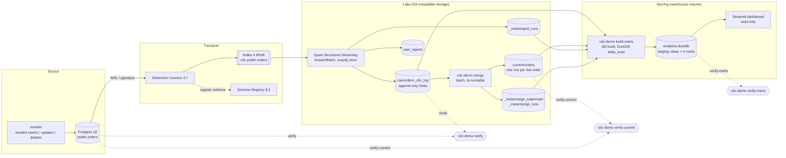

# cdc-streaming-demo

> Change data capture end to end on a laptop: every insert, update and delete on a Postgres
> table flows through Debezium and Kafka into an append-only Delta Lake log, written exactly once
> by Spark Structured Streaming.


## What this demonstrates

- Log-based CDC from the Postgres WAL with Debezium (`pgoutput`, a dedicated replication role,
  full before images, a consistent initial snapshot followed by streaming changes).
- Exactly-once landing into Delta Lake: Structured Streaming checkpoints plus idempotent
  `foreachBatch` writes (`txnAppId` / `txnVersion`), deterministic event ids from Kafka
  coordinates.
- A typed data contract at the raw layer, with rejected events kept in their own table with the
  reason, and one run-metadata row per micro-batch (counts, offsets, UTC times).
- Re-runnable infrastructure: connector registration and bucket creation are idempotent init
  containers, so `docker compose up` always converges to the same state.
- A current-state table kept by an incremental MERGE from the log, with an offset watermark.
- An analytics layer without a warehouse server: dbt-duckdb reads the Delta tables in place
  (DuckDB's `delta` extension over S3) and builds staging views and four marts with enforced
  contracts and tests; a Streamlit dashboard reads the resulting DuckDB file.
- A second way to capture changes: SQL Server CDC read directly by Spark with
  [mssql-cdc-pyspark](https://github.com/emanuel-luis/mssql-cdc-pyspark), landing in the same CDC
  log contract, compared with the Debezium path (see "Two ways to do CDC").
- An end-to-end check: `make demo` mutates the source with a seeded workload, asserts the
  lake against the mutator's manifest and against Postgres, then asserts the marts against
  the same manifest.

## Architecture



| Layer | Lives in | Contents |
| --- | --- | --- |
| Source | Postgres `public.orders` | The OLTP table the mutator changes |
| Transport | Kafka `cdc.public.orders` | Debezium change events (Protobuf, Confluent wire format), keyed by `id`, tombstone after each delete |
| Raw | Delta `s3a://cdc-demo/raw/orders_cdc_log` | One row per change event, never updated; partitioned by event date |
| Raw rejects | Delta `s3a://cdc-demo/raw/_rejects/orders_cdc_log` | Events that broke the contract, with the reason and Kafka coordinates |
| Run metadata | Delta `s3a://cdc-demo/_meta/ingest_runs` | One row per micro-batch: run id, batch id, counts, offset range |
| Processed | Delta `s3a://cdc-demo/current/orders` | One row per live order, the latest state; written only by `cdc-demo merge` |
| Merger control | Delta `s3a://cdc-demo/_meta/merge_watermark`, `_meta/merge_runs` | Last merged Kafka offset per partition; one row per merge run |

| Serving | DuckDB file `analytics.duckdb` in the `warehouse` volume | dbt staging views over the Delta tables and four marts: `dim_orders_current`, `fct_order_status_changes`, `fct_order_activity_hourly`, `fct_pipeline_runs`; written only by `cdc-demo build-marts` |
| Presentation | Streamlit at <http://localhost:8501> | Reads the DuckDB file read-only |

## Tech stack

Python 3.12 · PySpark 4.2 Structured Streaming · Delta Lake 4.4 · Debezium 3.7 · Protobuf with
Confluent Schema Registry · Kafka (Confluent Platform 8.3, KRaft) · PostgreSQL 18 · RustFS
(S3-compatible) · Docker Compose · Typer · pydantic-settings · uv · ruff · mypy ·
dbt-duckdb · DuckDB 2.0 · Streamlit · pytest + Hypothesis · GitHub Actions

## Quickstart

Requirements: Docker with Compose v2 (about 7 GB of memory free), `make` and `bash` (Linux,
macOS or WSL).

```bash
git clone https://github.com/emanuel-luis/cdc-streaming-demo && cd cdc-streaming-demo
make demo     # fresh stack, seeded workload, end-to-end assertions
make down     # stop everything and delete the volumes
```

`make demo` starts from empty volumes, waits for the 500-row initial snapshot to reach Kafka,
runs 200 seeded mutations and then polls the lake until it matches. It prints expected against
actual counts and exits non-zero on any mismatch. The stack stays up afterwards so you can look
around.

## Walkthrough

Ports are the defaults; change any of them in `.env` (copy `.env.example`).

1. **Bring the stack up.** `make up` starts Postgres, Kafka, Schema Registry, Debezium Connect,
   the object store and the consumer. Two init containers register the connector (`PUT`, so
   re-running is safe) and create the bucket.
2. **Watch the snapshot arrive.** Debezium reads the 500 seeded orders as `op = r` events:

   ```bash
   docker compose exec kafka kafka-console-consumer --bootstrap-server localhost:29092 \
     --topic cdc.public.orders --from-beginning --max-messages 3
   curl -s localhost:8083/connectors/orders-connector/status
   curl -s localhost:8081/subjects/cdc.public.orders-value/versions/latest
   ```

   The messages are binary Protobuf now, so the console shows raw bytes. Kafka UI (step 8) is
   configured with the registry to browse the schema subjects.
3. **Change the source.** The mutator advances order statuses, edits amounts, inserts and
   deletes, one transaction per change, and writes a manifest of what it did:

   ```bash
   docker compose run --rm mutator mutate --count 50 --seed 7 --manifest /runs/try.json
   ```
4. **See the changes land.** The consumer commits a micro-batch every 10 seconds. Check the
   lake with the same command the demo uses, or open the object store console at
   <http://localhost:9001> and browse `cdc-demo/raw/orders_cdc_log/`:

   ```bash
   docker compose run --rm spark-job verify --manifest /runs/try.json --timeout 120
   ```

   `verify` assumes a fresh stack with one mutator run, which is what `make demo` sets up.
5. **Merge into the current table.** `merge` reads the CDC log events above the watermark,
   keeps the latest event per order and applies them with a Delta MERGE. Run it twice: the
   second run reports 0 inserted, updated and deleted. `verify-current` then compares the
   current table with Postgres row by row and exits 1 on any difference:

   ```bash
   docker compose run --rm spark-job merge
   docker compose run --rm spark-job merge
   docker compose run --rm spark-job verify-current
   ```

   Mutate again and merge again to see only the new events picked up. Every run is recorded in
   `_meta/merge_runs` with the CDC log version it read and the MERGE row counts.
6. **Build the marts.** `build-marts` runs `dbt build` inside the `analytics` container. dbt
   reads the Delta tables straight from S3 with DuckDB's `delta` extension, builds into a
   staging DuckDB file and renames it over `analytics.duckdb` only when every model and test
   passed. `verify-marts` then checks the marts against the mutator manifest:

   ```bash
   make marts
   docker compose run --rm analytics verify-marts --manifest /runs/demo.json
   ```

   `make demo` already did both. Mutate and merge again, run `make marts` again, and the
   file is replaced with the new state.
7. **Dashboard.** `make dashboard` starts Streamlit at <http://localhost:8501>: live orders,
   CDC events, rejected messages, the last merge, orders by status, events per hour, the
   latest status changes and the latest pipeline runs. It does not refresh by itself;
   after `make marts`, reload the page. The caption shows when the marts were built.
8. **Optional UI.** `make ui` starts Kafka UI at <http://localhost:8090> (topics, decoded messages,
   the schema subjects, the Connect cluster). The Spark UI of the running consumer is at <http://localhost:4040>.

### Memory budget

Every long-running service has a memory limit in `compose.yaml`, sized for a 16 GB laptop
(peaks measured during `make demo`):

| Service | Limit | Measured peak |
| --- | --- | --- |
| postgres | 256 MB | 73 MB |
| kafka | 1 GB (heap 512 MB) | 690 MB |
| schema-registry | 512 MB (heap 256 MB) | 410 MB |
| connect | 1.25 GB (heap 512 MB) | 1.03 GB |
| s3 | 512 MB | 170 MB |
| consumer (Spark driver 1 GB) | 2.5 GB | 2.3 GB |
| analytics (short-lived, DuckDB capped at 512 MB) | 1 GB | 200 MB |
| dashboard (on demand) | 512 MB | 52 MB |
| mssql (SQL Server path only, server memory capped at 1536 MB) | 2 GB | [to be measured] |
| mssql-consumer (SQL Server path only, Spark driver 1 GB) | 2.5 GB | [to be measured] |

`verify`, `merge` and `verify-current` run in short-lived `spark-job` containers with the
consumer's limit, 2.5 GB (Spark driver 1 GB). Both Spark containers grow toward their limit:
the same `spark-job` runs peaked at 2.0 GB under an earlier 2 GB limit and at 2.4 GB under
2.5 GB, and none was killed, which points to page cache the kernel reclaims rather than heap.
The dashboard figure comes from health probes, with no browser session open. With the
consumer and a `spark-job` running, the whole stack used at most about 6.2 GB in one sample.

## Two ways to do CDC

The same `orders` table, the same seeded workload and the same CDC log contract, reached two
ways. The Debezium path above reads the Postgres WAL and goes through Kafka. The SQL Server
path reads SQL Server's own change tables directly from Spark with
[mssql-cdc-pyspark](https://github.com/emanuel-luis/mssql-cdc-pyspark), with no Kafka, no
Schema Registry and no Connect. Both land in the same Delta tables with the same schemas; the
SQL Server path writes under its own lake root, `s3a://cdc-demo/mssql`, because order ids 1 to
500 exist in both databases and their LSNs cannot be compared. The merger, dbt and the
verifiers run unchanged on either root.

```bash
MSSQL_ACCEPT_EULA=Y make mssql-demo   # instead of make demo, never next to it
make lag                              # p50, p95 and max lag of the stack that is up
make stats                            # memory of every running container
make down
```

Running this path means accepting Microsoft's
[SQL Server EULA](https://go.microsoft.com/fwlink/?linkid=857698): the compose file has no
default for `MSSQL_ACCEPT_EULA` and `make mssql-demo` refuses to start without `Y`. The image is
`linux/amd64` only (Apple Silicon needs emulation) and is not part of the PR checks; the
`mssql` workflow runs it on demand and weekly.

How the SQL Server path works:

1. `mssql-init` creates the database, `dbo.orders` (same columns and checks as Postgres), 500
   seeded rows, enables CDC on the table and creates two logins: an owner for the mutator and a
   reader with `SELECT` on the table and on `cdc.dbo_orders_CT` only.
2. `mssql-consumer` takes one snapshot of the table at a recorded LSN `L`
   (`format("mssql_cdc_snapshot")`) and writes it as `op = r` events, then streams the change
   table from `L` (`format("mssql_cdc")`, `startingLsn = L`). A restart finds `L` again in the
   log and resumes from the checkpoint.
3. Every micro-batch is mapped into the CDC log contract: an update is two source rows (before
   and after) and becomes one `u` event; the SQL Server LSN is packed into the `source_lsn`
   BIGINT; `kafka_offset` is a dense counter in the library's order. The mapping table is in
   [docs/PLAN.md](docs/PLAN.md), the reasons in decisions 45 to 55.

### What differs

| | Debezium path | SQL Server path (mssql-cdc-pyspark) |
| --- | --- | --- |
| Long-running services | postgres, kafka, schema-registry, connect, s3, consumer | mssql, s3, consumer |
| Memory limits in `compose.yaml` (long-running) | 6 GB in total (postgres 256 MB, kafka 1 GB, schema-registry 512 MB, connect 1.25 GB, s3 512 MB, consumer 2.5 GB) | 5 GB in total (mssql 2 GB, s3 512 MB, consumer 2.5 GB) |
| Measured peak memory | About 6.2 GB in one sample with a `spark-job` running (2026-10-25; per-service peaks under Memory budget) | [to be measured] (`make stats` during `make mssql-demo`) |
| Where the changes are read | the Postgres WAL, through a replication slot | the change table `cdc.dbo_orders_CT`, filled by the CDC capture job inside the source database |
| Replay buffer | the Kafka topic | the change table, trimmed by the CDC cleanup job |
| Order of events | `(source_lsn, kafka_offset)`, Postgres LSN and the Kafka offset | `(_start_lsn, _command_id, _seqval, _operation)` from the library, turned into a dense `kafka_offset`; `source_lsn` is the packed commit LSN |
| Update before image | needs `REPLICA IDENTITY FULL` (decision 9) | the before row (operation 3) is part of the change table; the mapping pairs it with the after row (operation 4) |
| Delete | a delete event, then a tombstone the consumer skips and counts | a delete row only, so `tombstones` is always 0; its values become the before image |
| Initial snapshot | Debezium's consistent snapshot, as `r` events through Kafka | `mssql_cdc_snapshot` at a recorded LSN, read under READ COMMITTED, written once as `r` events |
| Schema change | the Protobuf contract is checked in and `check-schema` fails on drift | the change table keeps its captured columns; the mapping fails loudly when the source columns differ from the expected ones; a new capture instance is the library's procedure ([schema changes guide](https://emanuel-luis.github.io/mssql-cdc-pyspark/guides/schema-changes/)) |
| Commit to lake lag (p50 / p95 / max) | [to be measured] (`make lag` after `make demo`) | [to be measured] (`make lag` after `make mssql-demo`) |
| Platform and license | `make demo` needs no EULA acceptance | SQL Server Developer EULA, `linux/amd64` image |

Notes on the table:

- Both paths write to Delta with the same mechanism: `txnAppId` and `txnVersion=batch_id` on
  every write, so a replayed batch is skipped. The offsets of the SQL Server path stay dense
  across batches because each batch starts after the highest `max_offset` in `ingest_runs`,
  which is written last.
- Ordering inside one SQL Server transaction follows the command id and the sequence value
  of the change table, as the library documents
  ([ordering changes](https://emanuel-luis.github.io/mssql-cdc-pyspark/reference/output-schema/));
  a test with two updates of one row in one transaction checks that the merged row is the
  last one.
- Retention is a real difference in kind. Postgres keeps WAL for a replication slot until the
  slot's consumer confirms it
  ([logical decoding](https://www.postgresql.org/docs/current/logicaldecoding-explanation.html)),
  so a stopped connector grows the disk. SQL Server's cleanup job deletes change rows after its
  retention period (three days by default, per the library's
  [bootstrap guide](https://emanuel-luis.github.io/mssql-cdc-pyspark/guides/bootstrap/)), so a
  consumer that stays stopped longer loses changes and the library fails or re-snapshots
  ([data loss](https://emanuel-luis.github.io/mssql-cdc-pyspark/guides/data-loss/)).
- Capture runs inside the source database. SQL Server CDC needs the Agent and writes change
  tables next to the data
  ([about change data capture](https://learn.microsoft.com/sql/relational-databases/track-changes/about-change-data-capture-sql-server)),
  which is why the demo container sets `MSSQL_AGENT_ENABLED`. Debezium adds a slot and a
  publication to Postgres instead.
- The numbers marked `[to be measured]` come from one run of the commands in their cells on
  one laptop; they will be filled in with the date of the run.

## Design notes

- **Exactly once into Delta.** The checkpoint records which Kafka offsets each batch covers. If
  the job dies after writing but before committing the checkpoint, the batch is replayed with
  the same `batch_id`; every write carries `txnAppId` + `txnVersion=batch_id`, so Delta skips
  the duplicate commit. `event_id` is `<topic>-<partition>-<offset>`, so a replay yields the
  same ids and `verify` can assert uniqueness.
- **Before images.** `orders` has `REPLICA IDENTITY FULL`; otherwise Postgres sends only the
  key in the before image and the old status of an update would be lost.
- **No secrets in connector config.** The connector reads the replication password through
  Kafka's `EnvVarConfigProvider` (`${env:CDC_DB_PASSWORD}`), so the Connect REST API never
  returns it.
- **Object storage.** The plan said MinIO, but its community edition was archived in April 2026
  and its images are no longer published. The code only speaks S3 (`s3a://` with path-style
  access), so the demo runs on RustFS; any S3-compatible server works by changing the `s3`
  service and the `S3_*` settings.

- **Protobuf and the schema contract.** Debezium writes keys and values through Confluent's
  Protobuf converter, which registers the value schema in Schema Registry (subject
  `cdc.public.orders-value`). Each Kafka value starts with a 6-byte header: magic byte 0, the
  4-byte schema id, and the message index `[0]` as one 0 byte (`Envelope` is the only top-level
  message). The consumer checks that header in Spark SQL, then decodes the rest with
  `from_protobuf`. The schema it decodes with is checked in:
  `src/cdc_demo/proto/orders_value.proto` is the registry's text, and `orders_value.desc` is the
  descriptor set compiled from it. Containers therefore need neither protoc nor a registry call
  at run time. `cdc-demo check-schema` (run by `make demo`) asks the registry whether the
  checked-in schema is compatible with the latest registered one and compares the two texts, so
  a Debezium upgrade that adds a field shows up as a failed check instead of silent drift. To
  change the contract: edit the `.proto`, run `make proto`, run the demo. Events with a bad
  header or a payload that does not decode go to the rejects table (base64 of the value).
  Proto3 scalars at their zero value decode as null.

- **dbt over Delta without Spark.** DuckDB reads the Delta tables where they are, so the
  analytics layer needs no Spark session and no copy of the data. DuckDB takes the S3
  credentials only for `s3://` paths, so the lake root `s3a://cdc-demo` is rewritten to
  `s3://cdc-demo` for dbt. The build writes to a staging file and renames it when dbt
  succeeds, so the dashboard never reads a half-built or failing warehouse. One check
  recomputes the current table from the CDC log (latest event per order up to the merge
  watermark) and compares both ways. The consumer creates its three Delta tables at
  startup, because the rejects table would otherwise not exist until the first reject.

- **The current table and its watermark.** `cdc-demo merge` is a batch job. It pins the latest
  version of the CDC log and reads it once with `versionAsOf`, because the consumer keeps
  appending and two reads could see different data. From that single read it takes the events
  above the watermark (the last merged Kafka offset per partition, in a Delta control table),
  keeps one event per order ordered by `(source_lsn, kafka_offset)`, and runs a MERGE that
  updates a row only when the incoming event is newer than the stored one. The watermark moves
  after the MERGE commits, using the highest offsets of that same read. A crash between the two
  steps is harmless: the re-run reads the same events and the newer-than guard turns them into
  no-ops. A delete event removes the row; the CDC log keeps the history.

Every decision and its reason is logged in [docs/DECISIONS.md](docs/DECISIONS.md); the build
plan is in [docs/PLAN.md](docs/PLAN.md).

## Project structure

```
compose.yaml              the whole stack (project name cdc-streaming-demo)
docker/                   mutator, Spark and analytics images (jars baked at build time), Connect image
postgres/initdb/          schema, seeded data, replication role, publication
mssql/init/               SQL Server setup: table, seed, CDC, logins (profile mssql)
debezium/                 connector configuration
scripts/                  connector registration, bucket creation, demo orchestration
src/cdc_demo/             the cdc-demo CLI: mutator, Spark ingest, merge, marts, verify, check-schema,
                          mssql (SQL Server path), lag
dbt/                      dbt-duckdb project: sources, staging views, marts, tests
dashboard/                Streamlit app over the DuckDB marts
src/cdc_demo/proto/       the Protobuf contract: .proto and compiled descriptor set
tests/                    unit and property tests; Spark tests behind the `spark` marker
docs/                     plan and decision log
```

## Development

```bash
make install      # uv sync --all-extras
make proto        # recompile the Protobuf descriptor set after editing the .proto
make lint         # ruff check, ruff format --check, mypy (strict), dbt parse
make test-fast    # unit and property tests, no JVM
make test-spark   # Spark tests (Linux, macOS, WSL or CI; needs Java 17)
```

## Roadmap

- [x] Minimum shippable: compose stack, mutator, raw CDC log in Delta, end-to-end check
- [x] Protobuf on the wire with Confluent Schema Registry and a schema contract test
- [x] Current-state table: incremental MERGE from the CDC log with an offset watermark
- [x] dbt (DuckDB) staging and marts, and a Streamlit dashboard
- [x] Two ways to do CDC: SQL Server CDC read directly by Spark with
      [mssql-cdc-pyspark](https://github.com/emanuel-luis/mssql-cdc-pyspark), compared with
      the Debezium path

## Related projects

- [kafka-streaming-lakehouse](https://github.com/emanuel-luis/kafka-streaming-lakehouse):
  application events instead of database changes, with its own producers, consumer groups, a
  dead-letter queue and Iceberg tables.
- [mssql-cdc-pyspark](https://github.com/emanuel-luis/mssql-cdc-pyspark): a PySpark streaming
  source for SQL Server CDC.

## License

MIT, see [LICENSE](LICENSE).
