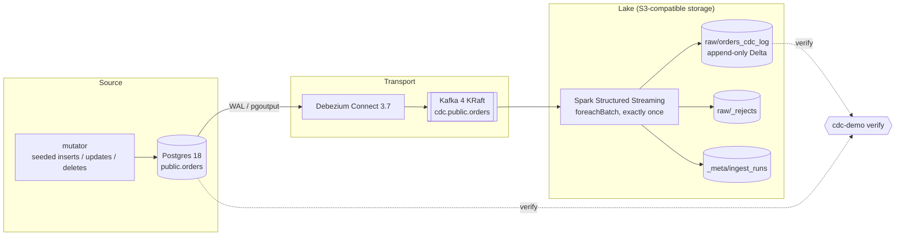

# cdc-streaming-demo

> Change data capture end to end on a laptop: every insert, update and delete on a Postgres
> table flows through Debezium and Kafka into an append-only Delta Lake log, written exactly once
> by Spark Structured Streaming.


## What this demonstrates

- Log-based CDC from the Postgres WAL with Debezium (`pgoutput`, a dedicated replication role,
  full before images, a consistent initial snapshot followed by streaming changes).
- Exactly-once landing into Delta Lake: Structured Streaming checkpoints plus idempotent
  `foreachBatch` writes (`txnAppId` / `txnVersion`), deterministic event ids from Kafka
  coordinates.
- A typed data contract at the raw layer, with rejected events kept in their own table with the
  reason, and one run-metadata row per micro-batch (counts, offsets, UTC times).
- Re-runnable infrastructure: connector registration and bucket creation are idempotent init
  containers, so `docker compose up` always converges to the same state.
- An end-to-end check: `make demo` mutates the source with a seeded workload and asserts the
  lake against the mutator's manifest and against Postgres.

## Architecture



| Layer | Lives in | Contents |
| --- | --- | --- |
| Source | Postgres `public.orders` | The OLTP table the mutator changes |
| Transport | Kafka `cdc.public.orders` | Debezium change events (JSON), keyed by `id`, tombstone after each delete |
| Raw | Delta `s3a://cdc-demo/raw/orders_cdc_log` | One row per change event, never updated; partitioned by event date |
| Raw rejects | Delta `s3a://cdc-demo/raw/_rejects/orders_cdc_log` | Events that broke the contract, with the reason and Kafka coordinates |
| Run metadata | Delta `s3a://cdc-demo/_meta/ingest_runs` | One row per micro-batch: run id, batch id, counts, offset range |

The processed layer (a current-state table built with MERGE) and the serving layer (dbt models
and a dashboard) are the next phases; see [Roadmap](#roadmap).

## Tech stack

Python 3.12 · PySpark 4.2 Structured Streaming · Delta Lake 4.4 · Debezium 3.7 · Kafka (Confluent
Platform 8.3, KRaft) · PostgreSQL 18 · RustFS (S3-compatible) · Docker Compose · Typer ·
pydantic-settings · uv · ruff · mypy · pytest + Hypothesis · GitHub Actions

## Quickstart

Requirements: Docker with Compose v2 (about 6 GB of memory free), `make` and `bash` (Linux,
macOS or WSL).

```bash
git clone https://github.com/emanuel-luis/cdc-streaming-demo && cd cdc-streaming-demo
make demo     # fresh stack, seeded workload, end-to-end assertions
make down     # stop everything and delete the volumes
```

`make demo` starts from empty volumes, waits for the 500-row initial snapshot to reach Kafka,
runs 200 seeded mutations and then polls the lake until it matches. It prints expected against
actual counts and exits non-zero on any mismatch. The stack stays up afterwards so you can look
around.

## Walkthrough

Ports are the defaults; change any of them in `.env` (copy `.env.example`).

1. **Bring the stack up.** `make up` starts Postgres, Kafka, Debezium Connect, the object store
   and the consumer. Two init containers register the connector (`PUT`, so re-running is safe)
   and create the bucket.
2. **Watch the snapshot arrive.** Debezium reads the 500 seeded orders as `op = r` events:

   ```bash
   docker compose exec kafka kafka-console-consumer --bootstrap-server localhost:29092 \
     --topic cdc.public.orders --from-beginning --max-messages 3
   curl -s localhost:8083/connectors/orders-connector/status
   ```
3. **Change the source.** The mutator advances order statuses, edits amounts, inserts and
   deletes, one transaction per change, and writes a manifest of what it did:

   ```bash
   docker compose run --rm mutator mutate --count 50 --seed 7 --manifest /runs/try.json
   ```
4. **See the changes land.** The consumer commits a micro-batch every 10 seconds. Check the
   lake with the same command the demo uses, or open the object store console at
   <http://localhost:9001> and browse `cdc-demo/raw/orders_cdc_log/`:

   ```bash
   docker compose run --rm spark-job verify --manifest /runs/try.json --timeout 120
   ```

   `verify` assumes a fresh stack with one mutator run, which is what `make demo` sets up.
5. **Optional UI.** `make ui` starts Kafka UI at <http://localhost:8090> (topics, messages,
   the Connect cluster). The Spark UI of the running consumer is at <http://localhost:4040>.

### Memory budget

Every long-running service has a memory limit in `compose.yaml`, sized for a 16 GB laptop:

| Service | Limit |
| --- | --- |
| postgres | 256 MB |
| kafka | 1 GB (heap 512 MB) |
| connect | 1 GB (heap 512 MB) |
| s3 | 512 MB |
| consumer (Spark driver 1 GB) | 2 GB |

## Design notes

- **Exactly once into Delta.** The checkpoint records which Kafka offsets each batch covers. If
  the job dies after writing but before committing the checkpoint, the batch is replayed with
  the same `batch_id`; every write carries `txnAppId` + `txnVersion=batch_id`, so Delta skips
  the duplicate commit. `event_id` is `<topic>-<partition>-<offset>`, so a replay yields the
  same ids and `verify` can assert uniqueness.
- **Before images.** `orders` has `REPLICA IDENTITY FULL`; otherwise Postgres sends only the
  key in the before image and the old status of an update would be lost.
- **No secrets in connector config.** The connector reads the replication password through
  Kafka's `EnvVarConfigProvider` (`${env:CDC_DB_PASSWORD}`), so the Connect REST API never
  returns it.
- **Object storage.** The plan said MinIO, but its community edition was archived in April 2026
  and its images are no longer published. The code only speaks S3 (`s3a://` with path-style
  access), so the demo runs on RustFS; any S3-compatible server works by changing the `s3`
  service and the `S3_*` settings.

Every decision and its reason is logged in [docs/DECISIONS.md](docs/DECISIONS.md); the build
plan is in [docs/PLAN.md](docs/PLAN.md).

## Project structure

```
compose.yaml              the whole stack (project name cdc-streaming-demo)
docker/app.Dockerfile     mutator image and Spark image (jars baked at build time)
postgres/initdb/          schema, seeded data, replication role, publication
debezium/                 connector configuration
scripts/                  connector registration, bucket creation, demo orchestration
src/cdc_demo/             the cdc-demo CLI: mutator, Spark ingest, verify
tests/                    unit and property tests; Spark tests behind the `spark` marker
docs/                     plan and decision log
```

## Development

```bash
make install      # uv sync --all-extras
make lint         # ruff check, ruff format --check, mypy (strict)
make test-fast    # unit and property tests, no JVM
make test-spark   # Spark tests (Linux, macOS, WSL or CI; needs Java 17)
```

## Roadmap

- [x] Minimum shippable: compose stack, mutator, raw CDC log in Delta, end-to-end check
- [ ] Protobuf on the wire with Confluent Schema Registry and a schema contract test
- [ ] Current-state table: incremental MERGE from the CDC log with an offset watermark
- [ ] dbt (DuckDB) staging and marts, and a Streamlit dashboard
- [ ] Two ways to do CDC: SQL Server CDC read directly by Spark with
      [mssql-cdc-pyspark](https://github.com/emanuel-luis/mssql-cdc-pyspark), compared with
      the Debezium path

## Related projects

- [kafka-streaming-lakehouse](https://github.com/emanuel-luis/kafka-streaming-lakehouse):
  application events instead of database changes, with its own producers, consumer groups, a
  dead-letter queue and Iceberg tables.
- [mssql-cdc-pyspark](https://github.com/emanuel-luis/mssql-cdc-pyspark): a PySpark streaming
  source for SQL Server CDC.

## License

MIT, see [LICENSE](LICENSE).
